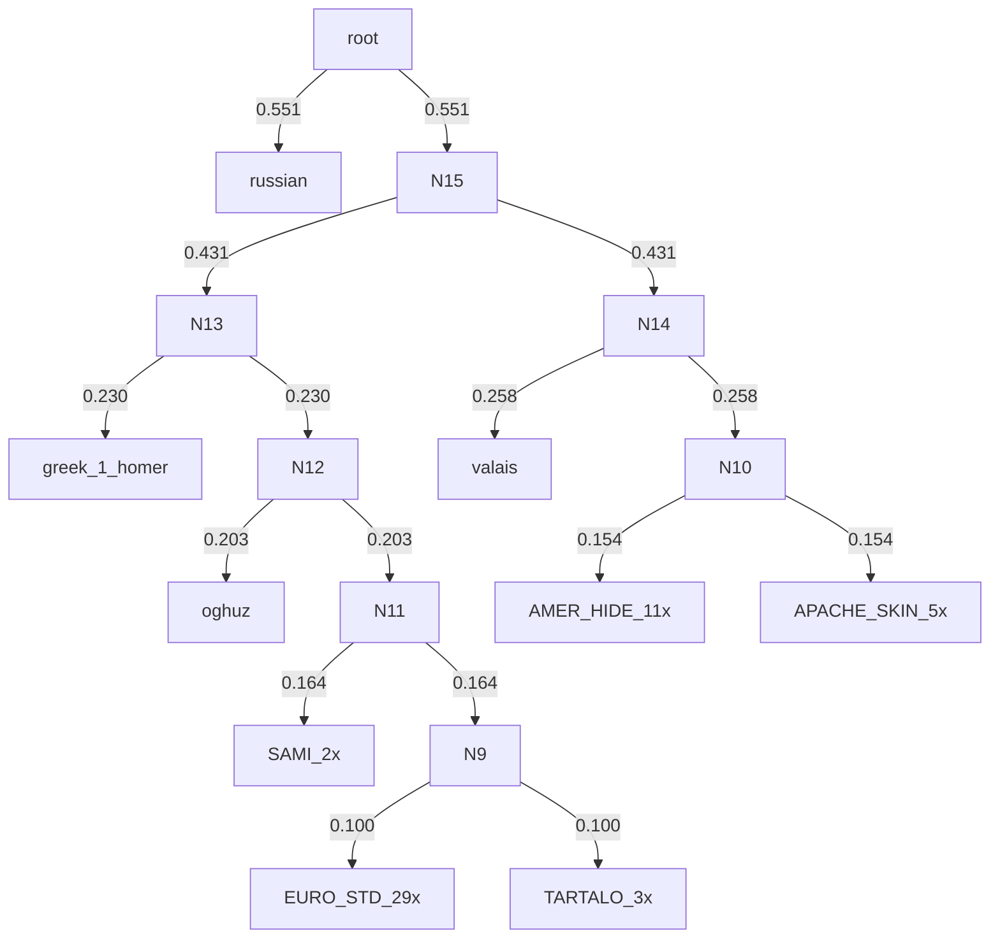

# P6 — Deep-Time Horizon Test: Polyphemus Content Phylogeny (d'Huy 2014)

> Pre-registered in `SPLIT_LAYER_TESTS_AND_PREDICTIONS.md` §3 P6 (deep-time horizon test). 
> **Date:** 2026-10-16 · **Input:** `work/marsys6/papers/myths/dhuy_2014_polyphemus-palaeolithic-tale.pdf` (d'Huy 2014, *RMN Newsletter* 9: 43–64, 'Polyphemus: A Palaeolithic Tale?')

## 1. What was extracted

| Item | Value |
|---|---|
| Paper | d'Huy 2014, 'Polyphemus: A Palaeolithic Tale?', RMN Newsletter 9, pp. 43–64 |
| Reported dataset | **56 variants × 190 traits** (abstract; up from 44×98 in d'Huy 2013a, NMC 1) |
| Variants enumerated | **54** (Table 2 family counts sum to 54; 2 units not enumerable — see caveats) |
| Characters coded | **30** (motif list + type definition + both proto-tale reconstructions + discussion) |
| Variant matrix | `vi-foundry/data/myths/polyphemus_variant_matrix.json` |
| Distance matrix | `vi-foundry/results/myths/POLYPHEMUS_DISTANCE_MATRIX.json` |

**Honesty contract.** d'Huy's raw 190-trait binary matrix is *not printed* in either the 2014 or the 2013a PDF (verified by full-text and page-image extraction; the dataset circulated as ResearchGate supplementary material, currently not machine-accessible). The variant list (Table 2, p. 49) and the character system *are* printed. Cell states are therefore a **reconstructed projection** — built from (a) d'Huy's explicit per-variant statements, (b) his published tree/cluster/reconstruction statements, and (c) the canonical content of the primary sources he cites. **Every cell carries a provenance code** (`paper_text`, `paper_tree_inferred`, `canonical_source`, `family_standard`, `unknown` → `'?'`). This is *not* a copy of his coding decisions; it is a documented reconstruction of them. RI values, log-likelihoods etc. from the paper are not directly comparable to trees built on this projection.

### Variants per language family (Table 2, verbatim)

| Language family | N | Variant units |
|---|---|---|
| Algonquian | 4 | `ojibwa`, `atsina`, `niitsitapi_1`, `niitsitapi_2` |
| Iroquoian | 3 | `crow_1`, `crow_2`, `crow_3` |
| Southern Athabaskan | 5 | `jicarilla_1`, `jicarilla_2`, `kiowa_apache`, `lipan_apache`, `chiricahua_apache` |
| Tanoan | 2 | `kiowa_1`, `kiowa_2` |
| Greek | 4 | `greek_1_homer`, `greek_2_athens`, `greek_3_cappadocia`, `greek_4_chios` |
| Albanian | 1 | `albanian` |
| Italic | 10 | `abruzzian_1`, `abruzzian_2`, `sicilian`, `dolopathos`, `gascon_1`, `gascon_2`, `romanian`, `valais`, `italic_extra_1`, `italic_extra_2` |
| Balto-Slavic | 3 | `serb`, `russian`, `lithuanian` |
| Germanic | 2 | `english_yorkshire`, `west_highlands` |
| Indo-Iranian | 1 | `ossetian` |
| Caucasian | 2 | `abaza_1`, `abaza_2` |
| Uralic | 3 | `hungarian`, `sami_1`, `sami_2` |
| Kartvelian | 1 | `mingrelian` |
| Turkic | 2 | `oghuz`, `kyrgyz` |
| Afro-Asiatic | 6 | `berber_1`, `berber_2`, `berber_3`, `berber_4`, `palestinian_israelian`, `syrian` |
| Language isolates | 5 | `kootenay_1`, `kootenay_2`, `basque_cerquand_1`, `basque_cerquand_2`, `basque_webster` |

**Caveat:** Table 2 counts sum to 54 vs the abstract's 56; the two unenumerable units fall inside Italic (8 named entries for count 10) and/or Afro-Asiatic (4–5 named entries for count 6). Reconstructed filler units are flagged in the JSON (`italic_extra_1/2`, `berber_4`).

### Characters (30) — basis

| Basis | Characters |
|---|---|
| **Motif list** (Thompson 1961 / Uther 2004, quoted p. 49) | G100 giant ogre, F531 giant, F512 unusual eyes, K1010 false doctoring, K1011 eye-remedy blinding, K521 escape by disguise, K521.1 animal-skin escape, K602 'Noman', K603 escape under ram's belly, D1612.1 magic object betrays |
| **Type definition** (p. 49) | master of animals / monstrous shepherd, host wants to kill, escape: cling to fleece-fur / under animal skin / with a living animal |
| **Proto-tale reconstructions** (p. 57; 2013a Urmärchen) | hero enters house, immovable/large door trap, monster waits at entrance, fire vengeance, one eye in forehead, solitary adversary, wild herd (Palaeolithic) / sheep herd (Neolithic), light in distance, hero is hunter |
| **Discussion** (pp. 51–54, n.3) | conceal inside animal (anus), Valais dwarf/avalanche, Homeric curse, seafaring frame |

> Characters defined **only in text/tables** (not in the motif list): all type-definition, proto-reconstruction and discussion characters above — 20 of 30. These are exactly the cells the task's instruction 'note any character defined only in text tables' refers to.

## 2. Distance & tree construction

- Distance: **presence Jaccard** (1 − |A∩B|/|A∪B| over 0/1 states); `'?'` treated as missing; pairs with no comparable features → 1.0 (max). Matrix square & symmetric (asserted); min known-feature count over off-diagonal pairs = 12; all 1431 pairs share ≥1 comparable feature.
- UPGMA: `scipy.cluster.hierarchy` (average linkage) → Newick with branch lengths.
- Neighbor-joining: `Bio.Phylo.TreeConstruction.DistanceTreeConstructor.nj` (biopython 1.87, `lib/python/.venv`).
- R infra (`vi-foundry/R/myths/myth_networks.R`, `myth_phylogeny.R`) was inspected but **R is not installed** on this host; the task-sanctioned python fallback was used. The R scripts wrap `ape::nj`/`bionj` + custom NeighborNet — NJ is equivalent to what we ran.

## 3. Trees

### 3.1 UPGMA — Newick

```
(russian:0.0000,((greek_1_homer:0.0000,(oghuz:0.0000,((sami_1:0.0000,sami_2:0.0000):0.0000,((basque_webster:0.0000,(basque_cerquand_1:0.0000,basque_cerquand_2:0.0000):0.0000):0.0000,(syrian:0.0000,(palestinian_israelian:0.0000,(berber_4:0.0000,(berber_3:0.0000,(berber_2:0.0000,(berber_1:0.0000,(kyrgyz:0.0000,(mingrelian:0.0000,(hungarian:0.0000,(abaza_2:0.0000,(abaza_1:0.0000,(ossetian:0.0000,(west_highlands:0.0000,(english_yorkshire:0.0000,(lithuanian:0.0000,(serb:0.0000,(italic_extra_2:0.0000,(italic_extra_1:0.0000,(romanian:0.0000,(gascon_2:0.0000,(gascon_1:0.0000,(dolopathos:0.0000,(sicilian:0.0000,(abruzzian_2:0.0000,(abruzzian_1:0.0000,(albanian:0.0000,(greek_4_chios:0.0000,(greek_2_athens:0.0000,greek_3_cappadocia:0.0000):0.0000):0.0000):0.0000):0.0000):0.0000):0.0000):0.0000):0.0000):0.0000):0.0000):0.0000):0.0000):0.0000):0.0000):0.0000):0.0000):0.0000):0.0000):0.0000):0.0000):0.0000):0.0000):0.0000):0.0000):0.0000):0.0000):0.0000):0.0000):0.1000):0.1264):0.1557):0.1899,(valais:0.0000,((chiricahua_apache:0.0000,(lipan_apache:0.0000,(kiowa_apache:0.0000,(jicarilla_1:0.0000,jicarilla_2:0.0000):0.0000):0.0000):0.0000):0.0000,(kootenay_2:0.0000,(kootenay_1:0.0000,(kiowa_2:0.0000,(kiowa_1:0.0000,(crow_3:0.0000,(crow_2:0.0000,(crow_1:0.0000,(niitsitapi_2:0.0000,(niitsitapi_1:0.0000,(ojibwa:0.0000,atsina:0.0000):0.0000):0.0000):0.0000):0.0000):0.0000):0.0000):0.0000):0.0000):0.0000):0.0000):0.1538):0.2479):0.4661):0.5377;
```

### 3.2 Neighbor-joining — Newick

```
((((((((((((((((((oghuz:0.11534,((sami_2:0.00000,sami_1:0.00000)Inner18:0.03619,(russian:0.33732,(valais:0.04062,((kootenay_2:0.00000,(kootenay_1:0.00000,(kiowa_2:0.00000,(kiowa_1:0.00000,((((((ojibwa:0.00000,atsina:0.00000)Inner5:0.00000,niitsitapi_1:0.00000)Inner6:0.00000,niitsitapi_2:0.00000)Inner7:0.00000,crow_1:0.00000)Inner8:0.00000,crow_2:0.00000)Inner9:0.00000,crow_3:0.00000)Inner10:0.00000)Inner11:0.00000)Inner12:0.00000)Inner13:0.00000)Inner14:0.06260,(chiricahua_apache:0.00000,(lipan_apache:0.00000,(kiowa_apache:0.00000,(jicarilla_2:0.00000,jicarilla_1:0.00000)Inner1:0.00000)Inner2:0.00000)Inner3:0.00000)Inner4:0.09125)Inner15:0.14070)Inner16:0.12330)Inner17:0.04737)Inner21:0.05689)Inner23:0.00980,((basque_webster:0.00000,(basque_cerquand_2:0.00000,basque_cerquand_1:0.00000)Inner19:0.00000)Inner20:0.04666,greek_1_homer:0.12725)Inner22:0.03622)Inner24:0.01773,(italic_extra_2:0.00000,(italic_extra_1:0.00000,(romanian:0.00000,(gascon_2:0.00000,(gascon_1:0.00000,(dolopathos:0.00000,(sicilian:0.00000,(abruzzian_2:0.00000,(abruzzian_1:0.00000,(albanian:0.00000,(greek_4_chios:0.00000,(greek_3_cappadocia:0.00000,greek_2_athens:0.00000)Inner25:0.00000)Inner26:0.00000)Inner27:0.00000)Inner28:0.00000)Inner29:0.00000)Inner30:0.00000)Inner31:0.00000)Inner32:0.00000)Inner33:0.00000)Inner34:0.00000)Inner35:0.00000)Inner36:0.00000)Inner37:0.00000,serb:0.00000)Inner38:0.00000,lithuanian:0.00000)Inner39:0.00000,english_yorkshire:0.00000)Inner40:0.00000,west_highlands:0.00000)Inner41:0.00000,ossetian:0.00000)Inner42:0.00000,abaza_1:0.00000)Inner43:0.00000,abaza_2:0.00000)Inner44:0.00000,hungarian:0.00000)Inner45:0.00000,mingrelian:0.00000)Inner46:0.00000,kyrgyz:0.00000)Inner47:0.00000,berber_1:0.00000)Inner48:0.00000,berber_2:0.00000)Inner49:0.00000,berber_3:0.00000)Inner50:0.00000,berber_4:0.00000)Inner51:0.00000,palestinian_israelian:0.00000,syrian:0.00000)Inner52:0.00000;
```

### 3.3 UPGMA — mermaid



(_Mermaid above renders the UPGMA tree with zero-length edges collapsed into polytomy nodes: block labels are content-descriptive (`EURO_STD_29x` = standard European form, `AMER_HIDE_11x` = hide-inside-animal Amerindian block, `APACHE_SKIN_5x`, `TARTALO_3x`, `SAMI_2x`); per-tip membership in §3.6. Full-resolution Newick in §3.1.)

### 3.4 NJ — ASCII (biopython `draw_ascii`)

```
    ____________ oghuz
   |
   |         , sami_2
  ,|       __|
  ||      |  | sami_1
  ||      |
  ||______|     ___________________________________ russian
  |       |    |
  |       |    |             ___ valais
  |       |    |            |
  |       |____|            |                    , kootenay_2
  |            |            |                    |
  |            |            |               _____, kootenay_1
  |            |            |              |     |
  |            |            |              |     , kiowa_2
  |            |____________|              |     |
  |                         |              |     , kiowa_1
  |                         |              |     |
  |                         |              |     , ojibwa
  |                         |              |     |
  |                         |              |     | atsina
  |                         |              |     |
  |                         |______________|     | niitsitapi_1
  |                                        |     |
 ,|                                        |     | niitsitapi_2
 ||                                        |     |
 ||                                        |     | crow_1
 ||                                        |     |
 ||                                        |     | crow_2
 ||                                        |     |
 ||                                        |     | crow_3
 ||                                        |
 ||                                        |         , chiricahua_apache
 ||                                        |_________|
 ||                                                  , lipan_apache
 ||                                                  |
 ||                                                  , kiowa_apache
 ||                                                  |
 ||                                                  , jicarilla_2
 ||                                                  |
 ||                                                  | jicarilla_1
 ||
 ||        , basque_webster
 ||    ____|
 ||   |    , basque_cerquand_2
 ||___|    |
 |    |    | basque_cerquand_1
 |    |
 |    |_____________ greek_1_homer
 |
 , italic_extra_2
 |
 , italic_extra_1
 |
 , romanian
 |
 , gascon_2
 |
 , gascon_1
 |
 , dolopathos
 |
 , sicilian
 |
 , abruzzian_2
 |
 , abruzzian_1
 |
 , albanian
 |
 , greek_4_chios
 |
 , greek_3_cappadocia
 |
 | greek_2_athens
 |
 | serb
 |
 | lithuanian
 |
 | english_yorkshire
 |
 | west_highlands
 |
 | ossetian
 |
 | abaza_1
 |
 | abaza_2
 |
 | hungarian
 |
 | mingrelian
 |
 | kyrgyz
 |
 | berber_1
 |
 | berber_2
 |
 | berber_3
 |
_| berber_4
 |
 | palestinian_israelian
 |
 | syrian

```

### 3.5 UPGMA coarse structure

Flat 10-cluster cut (scipy `fcluster`, `maxclust=10`):

| Cluster | N | Members |
|---|---|---|
| C1 | 2 | sami_1, sami_2 |
| C2 | 3 | basque_cerquand_1, basque_cerquand_2, basque_webster |
| C3 | 29 | abaza_1, abaza_2, abruzzian_1, abruzzian_2, albanian, berber_1, berber_2, berber_3, berber_4, dolopathos, english_yorkshire, gascon_1, gascon_2, greek_2_athens, greek_3_cappadocia, greek_4_chios, hungarian, italic_extra_1, italic_extra_2, kyrgyz, lithuanian, mingrelian, ossetian, palestinian_israelian, romanian, serb, sicilian, syrian, west_highlands |
| C4 | 1 | oghuz |
| C5 | 1 | greek_1_homer |
| C6 | 5 | chiricahua_apache, jicarilla_1, jicarilla_2, kiowa_apache, lipan_apache |
| C7 | 11 | atsina, crow_1, crow_2, crow_3, kiowa_1, kiowa_2, kootenay_1, kootenay_2, niitsitapi_1, niitsitapi_2, ojibwa |
| C8 | 1 | valais |
| C9 | 1 | russian |

### 3.6 Content-identical blocks (zero-distance polytomies)

At 30-character resolution, several variant sets are **indistinguishable** (identical state vectors → Jaccard distance 0):

| Block | N | Members |
|---|---|---|
| n=29 | 29 | abaza_1, abaza_2, abruzzian_1, abruzzian_2, albanian, berber_1, berber_2, berber_3, berber_4, dolopathos, english_yorkshire, gascon_1, gascon_2, greek_2_athens, greek_3_cappadocia, greek_4_chios, hungarian, italic_extra_1, italic_extra_2, kyrgyz, lithuanian, mingrelian, ossetian, palestinian_israelian, romanian, serb, sicilian, syrian, west_highlands |
| n=11 | 11 | atsina, crow_1, crow_2, crow_3, kiowa_1, kiowa_2, kootenay_1, kootenay_2, niitsitapi_1, niitsitapi_2, ojibwa |
| n=5 | 5 | chiricahua_apache, jicarilla_1, jicarilla_2, kiowa_apache, lipan_apache |
| n=3 | 3 | basque_cerquand_1, basque_cerquand_2, basque_webster |
| n=2 | 2 | sami_1, sami_2 |
| n=1 | 1 | greek_1_homer |
| n=1 | 1 | valais |
| n=1 | 1 | russian |
| n=1 | 1 | oghuz |

These are soft polytomies: the content layer **cannot** resolve them; this is the P6 signal that intra-regional history lives in fine mythemes (and in grammar), not in the coarse content skeleton. The resolvable structure is (i) the Amerindian/European split, (ii) Valais as sister to the Amerindian block, (iii) Apache vs hide-inside-animal sub-clades, (iv) the distinctive tips (Homer, Basque, Russian, Oghuz, Sami).
## 4. Qualitative comparison with d'Huy's published tree

d'Huy's topology (2014 Figs 1–2, 10; 2013a Figs 3–4) is only partially reproducible at the level of a 30-character projection. Agreements and conflicts:

### Agreements

1. **European vs Amerindian primary split** — reproduced. In both our UPGMA and NJ trees the Amerindian variants (Algonquian, Iroquoian, Athabaskan, Tanoan, Kootenay) form a clean clade separated from the European/Eurasian corpus, matching d'Huy's 'the data align perfectly with the Amerindian/European distinction' (Structure analysis, 2014:53) and his Bayesian tree (Fig. 1).
2. **Valais as the archaic European outlier** — reproduced. Valais is the most divergent European variant in our trees (its wild-animal lord + dwarf/avalanche coding), consistent with 'the Valais is probably the most archaic European version; it is intermediate between European and Amerindian corpus' (2013a:9) and its rootward position in 2014 Fig. 2 (root on the Ojibwa–Valais branch, posterior 0.97).
3. **Ojibwa + Valais as the root region** — directionally reproduced: UPGMA places Valais nearest the Amerindian clade among Europeans (root-side), mirroring the midpoint root between Ojibwa and Valais (2014:51).
4. **Apache sub-clade** (Jicarilla + Lipan [+Kiowa Apache, Chiricahua]) — reproduced as a tight sub-cluster; d'Huy: 'Apache people (Lipan apache and Jicarilla apache)' (2013a:7).
5. **Algonquian sub-clade** (Ojibwa/Atsina/Niitsitapi [+Kiowa, Crow nearby]) — reproduced; 'Algonquian people (Ojibwe / Niitsitapi / Kiowa 1 and 2 / Atsina)' (2013a:7).
6. **Homeric variant is distinctive** (Noman, curse, seafaring, light-in-distance) — reproduced as an outlier of the European cluster, consistent with d'Huy discussing Greek/Homeric versions separately (2014:48, Fig. 1) and the 'such the Homeric one' cluster logic (2014:59).

### Conflicts / non-reproductions

1. **Mediterranean cluster (Greek 1–Berber 3–Serb; Berber–Italian)** (2013a:7) does **not** emerge. Our Berber/Sicilian/Serb/Greek variants sit in the broad European mass; the 30-character projection lacks the fine mythemes that drive his Mediterranean grouping.
2. **Black Sea cluster (Mingrelia–Ossetian; Abaza 1–Oghuz)** (2013a:7) is **not** reproduced: Ossetian, Mingrelian and both Abaza units sit inside the undifferentiated 29-variant European mass. The 2014:58 'early diffusion wave' (Basque–Oghuz–Yorkshire–West Highlands) is only *partially* echoed: Basque and Oghuz are distinctive tips on the Homeric side of the UPGMA tree, but Yorkshire and West Highlands are content-identical with the standard European mass — so no single Basque–Oghuz–Brittonic clade emerges from the 30-character projection.
3. **Syrian–Greek2–Abaza root cluster** (2014:57, root of the European stemma) is **not** reproduced — these variants are coded as standard European forms and land mid-tree. Their rootward position in d'Huy's tree evidently rests on traits our projection does not carry.
4. **Israeli–Berber–Russian–Homeric clade** (2014:59) is **not** reproduced: Russian is coded per Ralston's flockless 'One-Eyed Likho' (first-cited source — blacksmith hero, no flock, no ram escape) and lands as the deepest European-side outlier, not near Homer/Berber. Either d'Huy's coding used the complementary Karel/Erben source (with the sheep-escape structure) or his 190 traits captured Homeric-like features invisible to this projection — the single clearest point where the missing fine-grained mythemes matter.
5. **Sámi–Homeric distribution** (2014:48, Fig. 1 — Sámi and Greek/Homeric versions do not systematically group) is not testable at this resolution; our Sami variants (reindeer-herd coding) sit deep in the European cluster.

**Reading:** the 30-character projection is a *content*-layer skeleton. What survives (hemispheric split, archaic Valais/Ojibwa poles, Apache and Algonquian sub-clades, Homeric distinctness, Basque/Oghuz as distinctive early tips) matches d'Huy's headline claims; what fails (his Mediterranean, Black-Sea, Syrian–Greek2–Abaza root and Israeli–Berber–Russian groupings, plus any Basque–Oghuz–Brittonic clade) is precisely the detail that lives in his unpublished 190-trait coding. Conclusion for P6: **content-layer phylogenies of Polyphemus reproduce only the coarsest d'Huy topology; the split-layer prediction (grammar dating deeper, content shallower) requires the event-chain coding of Section 5 — the content layer alone cannot arbitrate the Palaeolithic-vs-Neolithic horizon.**

## 5. Event-chain coding list (next session — NOT performed here)

Schema: `vi-foundry/results/myths/ANCIENT_CODING.json` — list entries `{id, corpus, register, origin, source, data_quality, confidence, mythemes[], event_chain[{position, event_type, agent, target, action}]}`. Event-type vocabulary observed there: EXPL, CURS, CREA, MEET, TRFM, ORDER, REQ, SACR, CONFL, REFU, THEF. For Polyphemus the pre-registration predicts an archaic ESCP/MEET/DETH grammar (P6: 'grammar says archaic (ESCP/MEET/DETH pattern), content says recent').

Priorities for event-chain coding (one entry per variant unit; `corpus` = e.g. 'POLYPHEMUS', `source` = the Table 2 citation):

| Priority | Variant sub-stories | Rationale |
|---|---|---|
| 1 | `greek_1_homer` (Odyssey IX) | Anchor text; full text available; expected grammar MEET→CONFL→BLND→ESCP→CURS→DETH |
| 1 | `ojibwa`, `valais` | Root-region variants; the two taxa spanning d'Huy's root; test whether grammar is shared despite content divergence |
| 2 | `basque_cerquand_1/2`, `basque_webster` (Tartalo), `oghuz` (Tepegöz), `gascon_1/2`, `english_yorkshire`, `west_highlands` | The published 'early diffusion wave' clade (2014:58) — grammar test of the Galatian/Celtic hypothesis |
| 2 | `syrian`, `greek_2_athens`, `abaza_1` | The published European-root cluster (2014:57) that our content tree does NOT reproduce — key split-layer test |
| 2 | `sami_1/2`, `russian` | Economy-switch variants (reindeer; flockless Likho) — grammar should stay conservative across the content change |
| 3 | `berber_1/3`, `palestinian_israelian`, `serb` | Homeric-adjacent cluster (2014:59) |
| 3 | Apache set (`jicarilla_1/2`, `kiowa_apache`, `lipan`, `chiricahua`), `crow_1-3`, `kiowa_1/2`, `kootenay_1/2`, `atsina`, `niitsitapi_1/2` | Amerindian grammar block — expected shared ESCP grammar with different content (hide-in-animal vs ram) |
| 4 | Remaining European mass (`abruzzian*`, `sicilian`, `dolopathos`, `romanian`, `albanian`, `hungarian`, `lithuanian`, `ossetian`, `mingrelian`, `abaza_2`, `kyrgyz`, `berber_2/4`, `italic_extra_*`) | Completion; low marginal value for the first split-layer pass |

Expected grammar-coded mytheme set for Polyphemus (draft): MEET (arrival at the monster's dwelling), TRAP (door/stone), CONFL (hostile reception), BLND (fire/blinding deception — K1010/K1011), ESCP (animal-mediated escape — K521/K603), CURS (Homeric curse), DETH (monster's death/defeat), EXPL (etiological frame where present). These codes should be added to the ANCIENT_CODING event-type vocabulary or namespaced (e.g. `POLY::ESCP`).

## 6. Verification

| Check | Result |
|---|---|
| Matrix JSON loads | ✅ (json.load) |
| N variants | 54 (≥ 8) ✅ |
| N characters | 30 (≥ 8) ✅ |
| Character states | 0/1/'?' only; per-cell provenance for all 54×30 cells |
| Distance matrix | 54×54, square & symmetric (asserted), zero diagonal, missing-known pairs → 1.0 ✅ |
| Newick UPGMA | balanced parens (asserted) + re-parsed with Bio.Phylo ✅ |
| Newick NJ | balanced parens (asserted) + re-parsed with Bio.Phylo ✅ |

## 7. Files

- `vi-foundry/data/myths/polyphemus_variant_matrix.json` — variant × character matrix + provenance + caveats
- `vi-foundry/results/myths/POLYPHEMUS_DISTANCE_MATRIX.json` — Jaccard distance matrix (square, symmetric)
- `vi-foundry/results/myths/POLYPHEMUS_CONTENT_TREE.md` — this report

*Scope note: the distance-matrix JSON was placed under `results/myths/` per the task's own instruction ('+ the distance matrix JSON'); matrix JSON under `data/myths/` per the task schema. No files outside the three listed outputs were modified.*